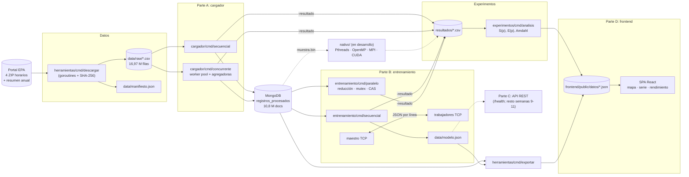
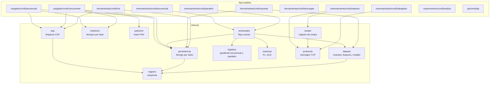
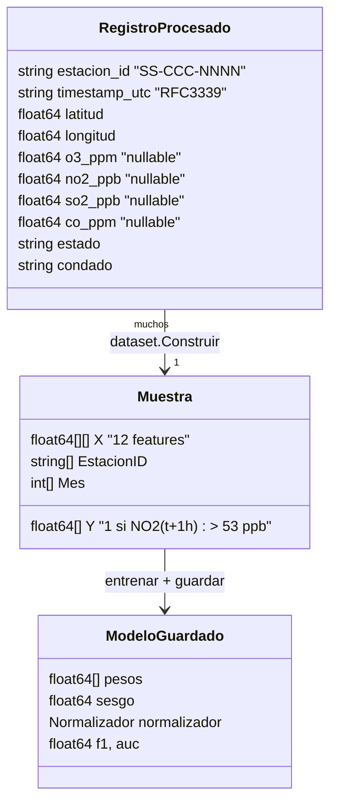
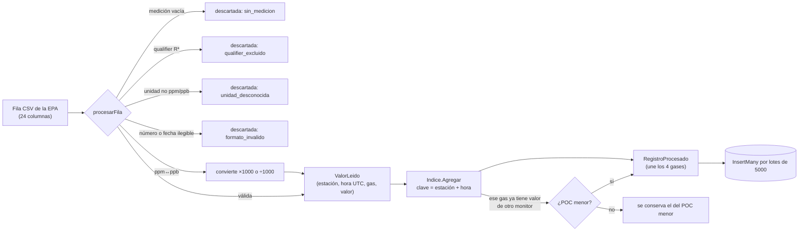
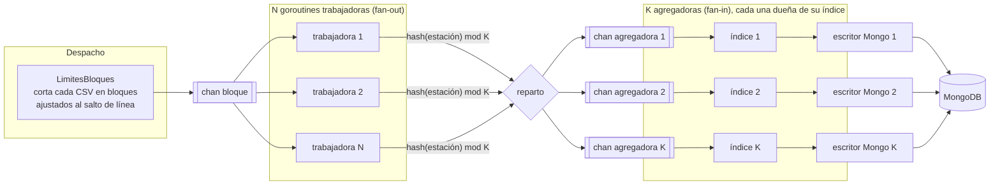
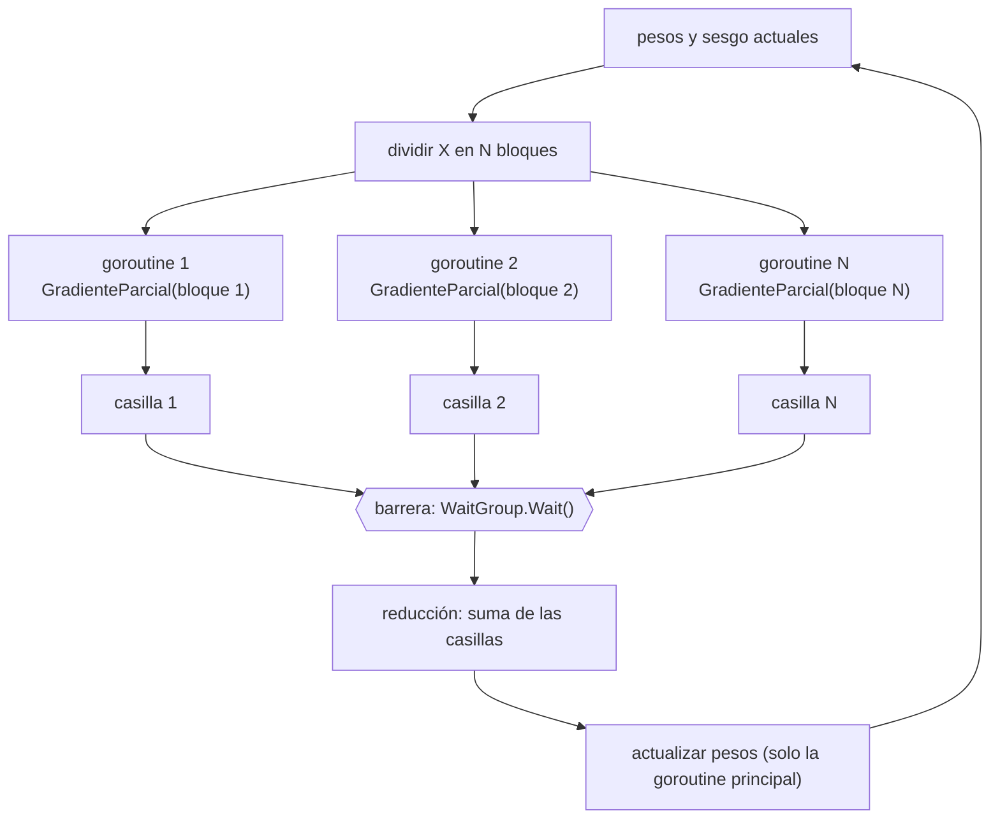
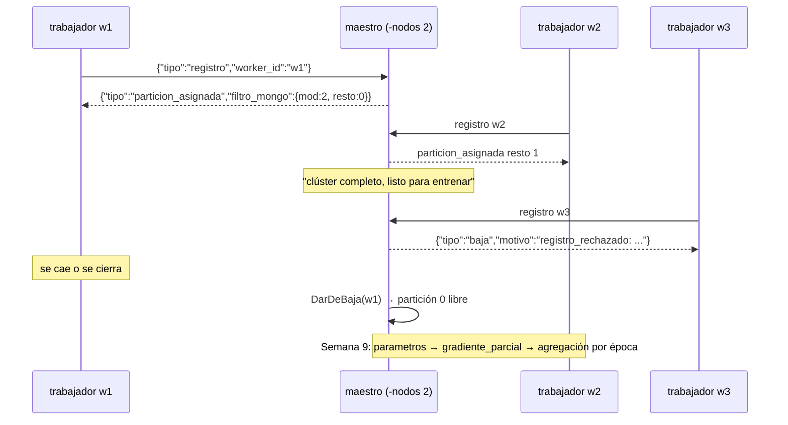
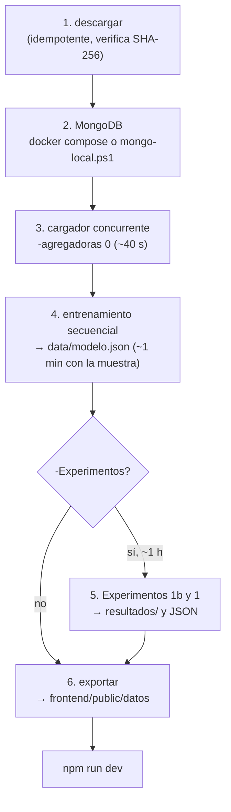

# Arquitectura y flujos de SACA

Este documento explica **cómo está construido el sistema y por dónde pasan los datos**, con diagramas. Los diagramas usan [Mermaid](https://mermaid.js.org/), que GitHub y VS Code (con la extensión "Markdown Preview Mermaid Support") muestran como imágenes.

Para **ejecutar** el proyecto ver [guia_ejecucion.md](guia_ejecucion.md). Para el detalle de cada programa y sus opciones, [funcionalidades.md](funcionalidades.md).

## 1. Vista general

| Parte | Responsabilidad | Modelo de paralelismo | Estado |
|---|---|---|---|
| A: cargador | Limpiar y unir los 4 CSV por (estación, hora) y guardarlos en MongoDB | Memoria compartida: goroutines + channels | ✅ |
| B: entrenamiento | Regresión logística que predice si el NO2 cruzará 53 ppb en 1 hora | Memoria compartida (goroutines) y paso de mensajes (TCP) | ✅ secuencial y paralelo, maestro y registro de nodos; ⏳ entrenamiento distribuido (semana 9) |
| C: API | Predicciones y control de entrenamientos para el frontend | Una goroutine por petición (la pone Go) | ⏳ solo `/health` |
| D: frontend | Mapa, serie con la predicción y panel de rendimiento | — | ✅ con datos reales exportados |
| Núcleos nativos | Las mismas piezas en Pthreads, OpenMP, MPI y CUDA | Los del sílabo | ⏳ semanas 8-13 |

## 2. Organización del código

Cada ejecutable vive en un `cmd/` y toda la lógica reutilizable en `internal/`. Las flechas indican "usa".

## 3. Modelo de datos

- Contrato del documento en Mongo: [contrato_registro_procesado.md](contrato_registro_procesado.md).
- Las 12 variables: NO2, O3, SO2 y CO actuales, latitud, longitud, y seno/coseno de la hora, el día de la semana y el mes (`dataset.NombresFeatures`).

## 4. Flujo de una fila: del CSV a MongoDB

En 2025: 16 972 287 filas leídas → 1625 descartadas por qualifier → 335 331 valores de monitores repetidos resueltos por POC → 10 838 667 registros únicos.

La regla del POC más bajo hace que el resultado **no dependa del orden** en que lleguen las filas. Sin ella, el cargador concurrente guardaba en esos 53 sitios un valor distinto en cada corrida. Esta condición de carrera *lógica* no la detecta `-race`, porque no hay accesos simultáneos a memoria; la descubrió la prueba end-to-end al comparar dos cargas.

## 5. Cargador concurrente: worker pool, fan-out y fan-in

Puntos de sincronización:

- `sync.WaitGroup` de las trabajadoras. Cuando terminan todas, se cierran los channels de las agregadoras, y así los `for range` terminan sin goroutines huérfanas.
- Conteo de filas con `sync.Mutex`, una vez por bloque.
- **Ningún lock en los índices**: cada clave tiene una sola agregadora dueña. Con `-agregadoras 1` se obtiene el diseño original, con una agregadora y un escritor; es la línea de comparación del Experimento 1.

## 6. Entrenamiento: una época en paralelo

Esa es la estrategia `reduccion`. Las estrategias `mutex` y `atomico` reemplazan las casillas privadas por **un acumulador compartido**, actualizado por cada ejemplo con `sync.Mutex` o con CAS. Dan el mismo resultado, pero son más lentas que el secuencial (Experimento 1b, [experimento1.md](experimento1.md)).

## 7. Protocolo maestro-trabajador (TCP)

- Cada conexión la atiende su propia goroutine. El registro de nodos (`internal/cluster`) es estado compartido protegido con `sync.Mutex`.
- Contrato completo: [contrato_protocolo_tcp.md](contrato_protocolo_tcp.md).
- En varias PCs: [guia_cluster.md](guia_cluster.md).

## 8. Pipeline completo (`scripts/pipeline.ps1` / `.sh`)

## 9. Prueba end-to-end (`herramientas/cmd/e2e`)

Recorre todo lo anterior con un **subconjunto de los datos reales**, en una base de datos temporal (`saca_e2e`). No toca `data/`, `resultados/` ni la base principal, y **no repite los experimentos largos**.

```mermaid
flowchart LR
    T1[herramientas] --> T2[compilar 10 programas] --> T3[go vet] --> T4["go test -race"]
    T4 --> T5[verificar CSV] --> T6["subconjunto<br/>150 mil filas × 4"] --> T7[ping Mongo]
    T7 --> T8[cargador secuencial] --> T9["concurrente 1 y N agregadoras<br/>= mismos registros"]
    T9 --> T10[entrenamiento + modelo] --> T11["paralelo × 3 estrategias<br/>= misma pérdida"]
    T11 --> T12["clúster: 2 nodos OK,<br/>1 rechazado, 1 caída"] --> T13[exportar JSON]
    T13 --> T14["análisis del Exp. 1b<br/>(CSV existente)"] --> T15["frontend: lint, build,<br/>servir JSON"]
```

## 10. Despliegue

| Escenario | Cómo |
|---|---|
| Una PC con Docker | `docker compose up -d mongo` y luego los programas con `go run` |
| Una PC Windows sin Docker | `scripts/mongo-local.ps1` (MongoDB portable) y luego los programas |
| Clúster del grupo | Maestro y Mongo en la PC principal; trabajadores y procesos MPI en las demás. Ver [guia_cluster.md](guia_cluster.md) |
